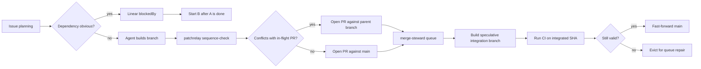

I was paying for reviews after clean rebases, and for repairs when parallel agents built branches that should have been sequenced. The two problems needed different fixes.

## Catch dependencies before the queue

Obvious dependencies belong in the task plan. patchrelay respects Linear `blockedBy`: if B depends on A, B waits until A is done.

For conflicts that only become visible once code exists, patchrelay runs `sequence-check` before PR creation. It compares the branch with in-flight PRs using `git merge-tree`. If a conflicting PR is likely to land first, the new PR can target that parent branch instead of `main`.

The merge queue still tests the combined result. merge-steward builds a speculative integration commit, runs CI, and fast-forwards `main` only while the tested commit remains valid.

Most branches can open against `main` and land independently. The checks catch the exceptions before another agent has to repair the consequences.

## Reuse a review after a clean rebase

A rebase changes the commit SHA even when it preserves the patch. Depending on the repository's branch protection settings, the push can dismiss approval and start another review.

review-quill computes `git patch-id --stable` and can republish a prior approval when the new head matches. Patch IDs normalize the diff, including whitespace; they don't establish that the surrounding code is unchanged. In `integration_tree` mode, the integrated tree must match too. [Merge trees](/posts/merge-trees) explains the distinction.

## What the checks caught

At this snapshot, patchrelay had recorded 2,710 runs across 733 issues. The local merge-steward databases held 1,477 queue entries: 1,306 merged, 166 evicted, and 5 dequeued.

Of the classifiable `sequence-check` outputs, 51 branches were cleared to open against `main` and 3 found a stack parent before PR creation.

review-quill had computed patch IDs for 1,564 attempts. In 42 cases it found a matching prior approval and carried it forward. Each avoided another review run.
