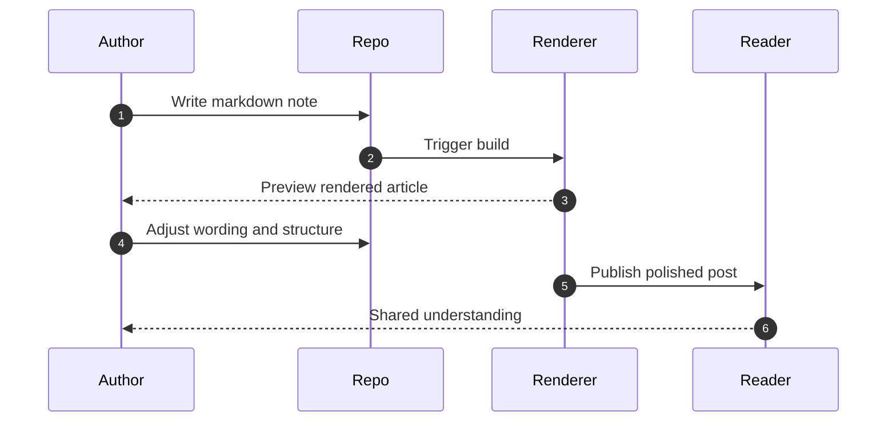
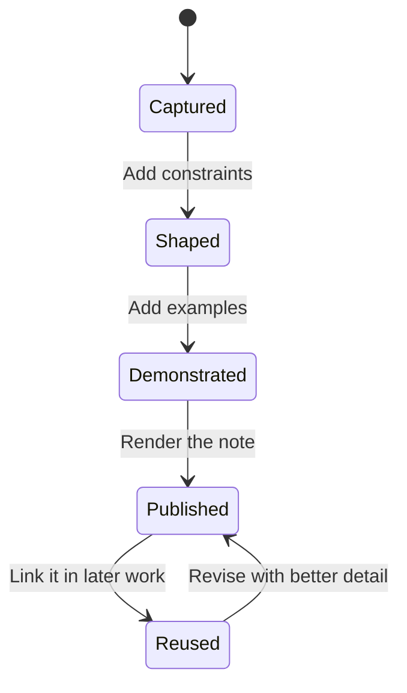
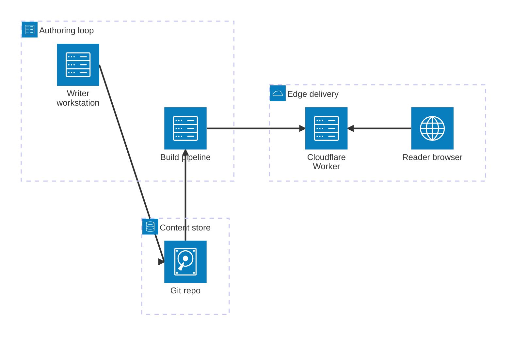

I use this first post to check how the blog renders headings, quotes, code, tables, and Mermaid diagrams. The examples below double as a rendering fixture.

## Headings and quotes

A heading separates sections. A blockquote should remain distinct from the surrounding prose:

> Check the rendered preview as well as the markdown source.

## Example source pattern

A short markdown example:

```md
## Outcome
Make the next step obvious.

## Constraints
- Keep the source static.
- Make diagrams easy to embed.
```

## Diagram examples

These four examples exercise different Mermaid renderers.

### 1. Flow of a note through the system


### 2. Review loop between author and publishing surface



### 3. State of an idea before it becomes useful



### 4. Architecture view of a tiny publishing factory



## Table example

The table should stay readable at narrow widths.

| Layer | Format | Why it exists |
|-|-|-|
| Source | Markdown | Easy to write and review |
| Structure | Frontmatter | Gives the post metadata |
| Diagram | Mermaid | Shows system flow clearly |
| Output | HTML | Makes the note pleasant to read |

## A small code example

Code blocks preserve indentation and scroll when needed:

```ts
type FactoryNote = {
  title: string;
  markdown: string;
  publishedAt: string;
};
```
